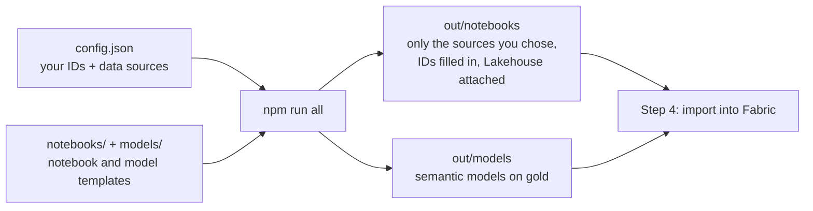

# Step 3: Configure

**What happens in this step:** you check that `config.json` has all your values (you filled most of them in during steps 1 and 2). A build command then puts those values into the notebooks and semantic model files, so you don't edit any notebook by hand. Everything runs on your PC; nothing goes to Fabric until step 4.



The steps: finish `config.json` (3.1) and run `npm run all` (3.2). You already have the code and `config.json` from [Before you start](../README.md#before-you-start).

## 3.1 Finish `config.json`

### Required: every setup

Check every row below; replace any `<...>` left over. The build warns about any you miss. The same guidance is in `config.json` itself as `//` comments next to each setting; they're allowed, so leave them in.

| Field | Value | Where you got it |
|---|---|---|
| `tenantId` | Directory (tenant) ID | [2.1](../02-permissions/README.md#21-register-the-app-and-add-permissions), app Overview |
| `appId` | Application (client) ID | [2.1](../02-permissions/README.md#21-register-the-app-and-add-permissions), app Overview |
| `workspace.id` | GUID after `/groups/` in the URL | [1.4](../01-fabric/README.md#14-copy-three-values-from-fabric) |
| `workspace.name` | The workspace name | 1.2 |
| `lakehouse.id` | GUID after `/lakehouses/` in the URL | [1.4](../01-fabric/README.md#14-copy-three-values-from-fabric) |
| `lakehouse.sqlEndpoint` | Host only: `xxxx.datawarehouse.fabric.microsoft.com` | [1.4](../01-fabric/README.md#14-copy-three-values-from-fabric) |
| **Secret: one of** | **Key Vault (recommended):** `keyVault.uri` = `https://<name>.vault.azure.net/`, and leave `clientSecret` as `""`.<br>**Bypass (not recommended):** leave `keyVault.uri` as it is and put the secret value in `clientSecret`. | [2.2](../02-permissions/README.md#22-store-the-client-secret) |
| `dataSources` | Which sources to load; see the next table. Set what you don't use to `skip`. | [Before you start](../README.md#before-you-start) |

**`dataSources`**

This is your list of what to load. For each source, the build:

* **`api`**: includes the notebook that pulls the data straight from Microsoft (Graph, audit log, Azure, Dataverse) using the app from step 2.
* **`csv`**: includes the notebook that reads a file you export yourself. Use it when there's no API or you lack the permission. You only need the file downloaded and saved on your PC now: `Lake_Init` creates its Lakehouse folder in step 4.3 and you upload it in step 4.6.
* **`skip`**: leaves that source out: no notebook, no tables, and its semantic model isn't built.

It also prints the Graph permissions the chosen sources need, so you can check them against step 2.

> **Before you set a source to `csv`, make sure you have its export file** (or can get it: see [step 4.6](../04-import/README.md#46-upload-csv-exports-only-sources-set-to-csv) for where it comes from and who can export it). Without the file the run still finishes, but that source's tables stay empty and its report pages are blank. If you don't have it yet, set the source to `skip` for now.

| Source | Required? | Allowed | Notes |
|---|---|---|---|
| `copilotInteractions` | **Required** | `api` | Copilot prompts and responses, from the audit log |
| `orgData` | **Required** | `api` | Users, departments, managers |
| `m365Activity` | Optional | `api`, `skip` | Teams, Outlook, Word, Excel, PowerPoint usage |
| `agent365` | Optional | `api`, `csv`, `skip` | `csv` if you lack Agent 365 or its Graph permissions |
| `workday` | Optional | `csv`, `skip` | Only if org data comes from a Workday export |
| `productFeedback`, `studioCredits`, `coworkCredits` | Optional | `csv`, `skip` | You upload the exports in step 4 |
| `azureAi` | Optional | `api`, `skip` | Also fill in `azure.subscriptionId` (below) |
| `agentEvaluator` | Optional | `api`, `skip` | Also fill in `dataverseEnvironments` (below) |

### Optional: only if you turned on that source

| Field | Fill in when | Otherwise |
|---|---|---|
| `azure.subscriptionId` | `azureAi` is `api`: the subscription that holds your Azure AI resources | leave `""` |
| `azure.paygSubscriptions` | Copilot pay-as-you-go is billed to other subscriptions: list their IDs | leave `[]` |
| `dataverseEnvironments` | `agentEvaluator` is `api`: add one `{ "url": "https://<org>.crm.dynamics.com", "name": "..." }` per Copilot Studio environment (example in the template's comment) | leave `[]` |

### Optional: defaults are fine

| Field | Default | Change it when |
|---|---|---|
| `scale` | `standard` | Use `large` above ~20k Copilot users (see 1.1) |
| `backfillDays` | `30` | You want more audit history in the first load (max 180) |
| `keyVault.secretName` | `universal-lake-client-secret` | You named the secret differently in 2.2 |
| `lakehouse.name` | `UniversalLake_LH` | You named the Lakehouse differently in 1.3 |
| `semanticModels`, `modelSchema` | as shipped | Leave them |

## 3.2 Generate the files to import

```powershell
npm run all
```

This only writes files on your PC. It picks the notebooks your `dataSources` need, fills in your IDs, builds the semantic model definitions for the `gold` schema, and builds this repo's `Lake_*` notebooks. Output:

| Folder | Contains | Used in |
|---|---|---|
| `out/notebooks/` | Every notebook to import, with your Lakehouse attached; `MANIFEST.json` lists them | Step 4.1 |
| `out/models/` | One `definition.json` per semantic model, plus readable `model.bim` and `relationships.txt`, and `gold_tables.json` | Step 4.5 |

**Read the console output:**

* **Warnings** mean a value is still a placeholder. Fix `config.json` and run `npm run all` again until there are none.
* It prints the **Graph permissions** your notebooks need. Compare them with step 2.
* *"notebooks are unbound"* means `workspace.id` or `lakehouse.id` is missing.
* With the bypass, it warns that the secret was written into `out/notebooks`. That's expected; don't share that folder.

(`npm` is just the script runner here. `npm run all` = `check`, `sync`, `models`, `notebooks`; each can be run on its own.)

Next: [Step 4: Import into Fabric](../04-import/README.md)
