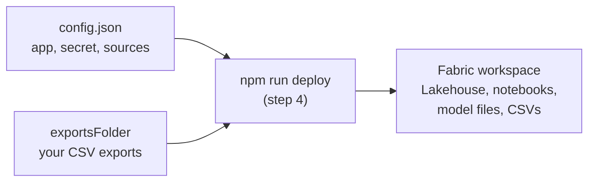

# Step 3: Configure

**What happens in this step:** you finish `config.json` and gather your CSV exports in one folder. Everything stays on your PC; step 4 sends it to Fabric.



## 3.1 Finish `config.json`

### Required: every setup

Replace any `<...>` left over. The same guidance is in `config.json` itself as `//` comments; leave them in.

| Field | Value | Where you got it |
|---|---|---|
| `tenantId` | Directory (tenant) ID | [2.1](../02-permissions/README.md#21-register-the-app-and-add-permissions), app Overview |
| `appId` | Application (client) ID | [2.1](../02-permissions/README.md#21-register-the-app-and-add-permissions), app Overview |
| `fabricTenantId` | Leave `""`. Deploy asks whether your Fabric workspace is in the same tenant as the app and fills this in. If it isn't (for example, the data is in a demo tenant), you enter the Fabric tenant's ID or a domain you sign in with, e.g. `contoso.com`. | Fabric portal > **?** > **About** > *Tenant URL* or ID |
| `workspace.name` | The workspace name | [1.2](../01-fabric/README.md#12-create-the-workspace) |
| **Secret: one of** | **Key Vault (recommended):** `keyVault.uri` = `https://<name>.vault.azure.net/`, and leave `clientSecret` as `""`.<br>**Bypass (not recommended):** leave `keyVault.uri` as it is and put the secret value in `clientSecret`. | [2.2](../02-permissions/README.md#22-store-the-client-secret) |
| `dataSources` | `api`, `csv` or `skip` for each source; see below | [Before you start](../README.md#before-you-start) |
| `exportsFolder` | The folder with your CSV exports, e.g. `D:/lake-exports`. Use forward slashes (or write each `\` as `\\`). Leave `""` if you have no CSV sources. | [3.2](#32-put-your-csv-exports-in-one-folder) |

You **don't** fill in `workspace.id`, `lakehouse.id` or `lakehouse.sqlEndpoint`: deploy finds or creates them and writes them in.

**`dataSources`**

* **`api`**: the notebook pulls the data straight from Microsoft (Graph, audit log, Azure, Dataverse) using the app from step 2.
* **`csv`**: the notebook reads an export you saved (3.2). Use it when there's no API or you lack the permission.
* **`skip`**: left out entirely: no notebook, no tables, and its semantic model isn't built.

| Source | Required? | Allowed | Notes |
|---|---|---|---|
| `copilotInteractions` | **Required** | `api` | Copilot prompts and responses, from the audit log |
| `orgData` | **Required** | `api` | Users, departments, managers |
| `m365Activity` | Optional | `api`, `skip` | Teams, Outlook, Word, Excel, PowerPoint usage |
| `agent365` | Optional | `api`, `csv`, `skip` | `csv` if you lack Agent 365 or its Graph permissions |
| `workday` | Optional | `csv`, `skip` | Only if org data comes from a Workday export |
| `productFeedback`, `studioCredits`, `coworkCredits` | Optional | `csv`, `skip` | Exports only |
| `azureAi` | Optional | `api`, `skip` | Also fill in `azure.subscriptionId` (below) |
| `agentEvaluator` | Optional | `api`, `skip` | Also fill in `dataverseEnvironments` (below) |

No export file yet for a `csv` source? Leave it as `csv`: the lake still builds, that source's tables stay empty, and deploy tells you which file is missing. Or set it to `skip` for now.

### Optional: only if you turned on that source

| Field | Fill in when | Otherwise |
|---|---|---|
| `azure.subscriptionId` | `azureAi` is `api`: the subscription that holds your Azure AI resources | leave `""` |
| `azure.paygSubscriptions` | Copilot pay-as-you-go is billed to other subscriptions: list their IDs | leave `[]` |
| `dataverseEnvironments` | `agentEvaluator` is `api`: one `{ "url": "https://<org>.crm.dynamics.com", "name": "..." }` per Copilot Studio environment | leave `[]` |

### Optional: defaults are fine

| Field | Default | Change it when |
|---|---|---|
| `scale` | `standard` | Use `large` above ~20k Copilot users (see 1.1) |
| `backfillDays` | `30` | You want more audit history in the first load (max 180) |
| `keyVault.secretName` | `universal-lake-client-secret` | You named the secret differently in 2.2 |
| `lakehouse.name` | `UniversalLake_LH` | You want another name, or to use a Lakehouse you already have |
| `semanticModels`, `modelSchema` | as shipped | Leave them |

## 3.2 Put your CSV exports in one folder

Save every export in the `exportsFolder` folder, **exactly as downloaded**: don't rename them, subfolders are fine. Deploy reads each file's column headers to tell which source it belongs to, uploads it, and ignores anything it doesn't recognise. You only need files for sources set to `csv`.

| Source | Export from | Who can export |
|---|---|---|
| `agent365` | Microsoft 365 admin center > **Agents > All agents > Export** | A Microsoft 365 admin who can see the Agents page |
| `productFeedback` | Microsoft 365 admin center > **Health > Product feedback > Export** | Global Administrator or Reports Reader |
| `studioCredits` | Power Platform admin center > **Licensing > Copilot Studio** > download the reports (files below) | Power Platform Administrator |
| `coworkCredits` | Viva Insights > **Copilot Consumption Dashboard > Export** (files below) | Insights Analyst |
| `workday` | Workday report of active workers with Primary Work Email, as CSV | Your Workday team |

### Studio and Viva: which files

| File as downloaded (the date part varies) | Fills table | Needed? |
|---|---|---|
| `EntitlementConsumptionTenantDetailsReport_MCSMessages….csv` | `studio_tenant_daily` (credits per environment per day) | **Yes**: the only Studio file with dates, used for all totals and trends |
| `EntitlementConsumptionTenantPerAgentDetailsReport_MCSMessages….csv` | `studio_agent` (credits per agent) | Recommended |
| `EntitlementConsumptionTenantPerUserDetailsReport_MCSMessages….csv` | `studio_user` (credits per user per agent) | Optional |
| `PersonServiceCreditsMetrics….csv` | `viva_credits_weekly` (credits per person per week) | **Yes**, for `coworkCredits` |
| `SpendingPolicyMetadata….csv` | `viva_spending_policy` (policy names and limits) | Optional: without it, policies show as IDs |

Files named after the lake's tables (`studio_agent.csv`, `viva_credits_weekly.csv`, ...) are outputs, not exports: don't put them in the folder.

* **Studio's per-agent and per-user files have no dates.** They're totals for the period you exported, stamped with the month the notebook runs. Export them once a month to build history.
* **Viva only keeps 6 months.** Export at least monthly; older weeks stay in the lake once loaded.
* Exporting the same period again is safe: rows are updated, not duplicated.

## 3.3 Optional: build on your PC first

`npm run deploy` builds everything itself. To look at what it will send first:

```powershell
npm run all
```

This writes `out/notebooks/` (the notebooks, with your values filled in) and `out/models/` (the semantic models), and prints the Graph permissions your sources need, so you can compare them with step 2. Warnings mean a value is still a placeholder.

### If `npm` doesn't work

The build downloads no packages, so `npm` is only a shortcut. If it's blocked (common on managed corporate PCs), run the scripts directly from the repo folder:

```powershell
node scripts/deploy.mjs            # instead of npm run deploy (add --dry-run etc. as usual)
node scripts/sync_notebooks.mjs    # these three are npm run all
node scripts/build_models.mjs
python scripts/build_ipynb.py
```

Next: [Step 4: Deploy to Fabric](../04-deploy/README.md)
