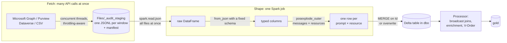

# How the ingesters work

The ingesters don't loop over records one at a time, building rows in Python or Power Query. Each one does two separate jobs:

1. **Fetch.** Pull raw API responses quickly, in parallel, and save them somewhere so a failure doesn't lose work.
2. **Shape.** Hand the raw data to Spark in one go and let it parse, flatten and write Delta in parallel across the cluster.

## 1. Fetching: parallel, throttling-aware, resumable

| Ingester | How it fetches in parallel |
|---|---|
| **Audit log** (Copilot interactions) | Splits the backfill into time windows (1 day on `standard`, 2 hours on `large`) and runs **up to 5 Purview audit queries at once**. Purview allows about 10 per tenant, so there's room left for other admins. |
| **M365 activity** | For each day, pulls the 6 usage reports (Teams, Outlook, SharePoint, OneDrive, Viva Engage, apps) **3 at a time**. |
| **Agent 365 registry** | Fetches agent details with **8 parallel workers**. It looks up owners with Graph **`$batch`** (20 users per request) instead of one call each. |
| **Org data, licensed users** | Follows `@odata.nextLink` paging. Each is one fast list, so there's nothing worth parallelising. |

Features shared by every fetch:

* **Throttling handled for you.** HTTP 429 and 5xx responses are retried with exponential backoff, honouring `Retry-After`. In the audit ingester, every 429 also **lowers the number of queries run at once** for the rest of the run, so it slows down instead of failing.
* **Self-healing windows.** An audit window that keeps failing or timing out is **split in half**, down to 1 hour, and the halves are queried instead. One bad hour doesn't block a 30-day backfill.
* **Resumable.** Each finished audit window is written to `Files/_audit_staging` as its own JSONL file and recorded in a manifest. A rerun (or an [automatic resume](05-ingest/README.md#the-audit-backfill-what-to-expect)) skips finished windows, and later daily runs read only their own windows.
* **Large lookups are saved as they go.** The registry ingester saves fetched details to `agents_365_detail_cache` every 1,000 agents, so an interruption costs minutes, not the whole run.

## 2. Shaping: column-wise in Spark, not row by row

The Copilot audit record is deeply nested JSON. One interaction holds an array of messages, and each message can touch an array of resources (files, sites, plugins). The older Power BI approach expanded this in Power Query (`Json.Document` → `ExpandListColumn` → `ExpandRecordColumn`). That ran one row at a time inside the refresh, and was the step that stopped the refresh from being pushed down to the source.

The ingesters do it in Spark instead:

* **One read for everything.** `spark.read.json(files)` loads all the staged windows as a single DataFrame, spread over the cluster's cores.
* **A fixed schema, applied column-wise.** `from_json(AuditData, audit_schema)` parses every record's JSON against a declared `StructType` in one vectorised pass. There's no schema guessing, and malformed or empty records are filtered out, not crashed on.
* **Explosion instead of nested loops.** `posexplode_outer` turns the `Messages` array, then the `Resources` array, into rows across all partitions at once. The `_outer` keeps interactions that have no messages or resources (left-join semantics). The position it returns becomes `Message_Ordinal` and `Resource_Ordinal`, so every row has a **stable, reproducible key**.
* **Deterministic IDs.** Row keys are hashes of the canonicalised JSON (keys sorted, whitespace normalised). The same record always gets the same `Id`, whichever window or rerun delivered it, so `dropDuplicates(['Id'])` and the Delta `MERGE` remove overlaps between windows.

## 3. Writing Delta: idempotent and incremental

* **MERGE on a stable key.** Daily runs `MERGE` on `Id` (`whenMatchedUpdateAll` / `whenNotMatchedInsertAll`), so a rerun or an overlapping window updates rows instead of duplicating them. Backfills use `overwrite`.
* **Day-level replace.** M365 activity writes each day with `replaceWhere ActivityDate = <day>`. Microsoft's reports fill in late, so it re-reads the last 4 days and swaps just those day slices, without touching the rest of the table.
* **Schema evolution.** `mergeSchema` / `schema.autoMerge` let new optional columns from Microsoft land without breaking the table.

## 4. Processing: enrichment in Spark, not in the model

The processor turns `Copilot_Interactions_Parsed` into the curated fact table that the models read:

* **Broadcast joins.** Small dimensions (licensed users, agent registry, agent links, user-month lookups) are `broadcast` to every executor. The large fact table is never shuffled to join them.
* **Former DAX columns computed once.** About 30 behaviour columns that the Power BI template used to compute as DAX calculated columns at every refresh are computed once in Spark. The fact table imports with **no calculated columns**, so refreshes stay fast and the model can use Direct Lake.
* **`OPTIMIZE … VORDER`.** It compacts small files and applies V-Order, the column layout that Power BI's engine reads fastest, for both import and Direct Lake.

## Why this matters

| | Row-by-row (Power Query / Python loops) | These ingesters |
|---|---|---|
| API calls | One at a time | Several at once, backing off when throttled |
| A failure at hour 3 of a backfill | Start over | Resume from the last finished window |
| Nested JSON | Expanded row by row during refresh | Parsed and exploded column-wise across the cluster |
| Reruns and overlaps | Duplicates or a full reload | Deterministic keys, `MERGE` / `replaceWhere` |
| Model refresh | Recomputes calculated columns | Reads ready-made, V-Ordered gold tables |

Next: [the steps](README.md#steps)
