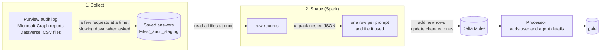

# How it works

You don't need any of this to set up the lake. It's here if you want to know what's inside.

## What's in the Lakehouse

You'll see these as folders (schemas) in the Lakehouse. Data moves from raw, to cleaned, to report-ready.

| Folder | What's in it | Do you use it? |
|---|---|---|
| `gold` | The report-ready tables. The semantic models read only these. | **Yes.** Point reports, apps and SQL here. |
| `silver` | Cleaned data and history the models don't read | Rarely |
| `bronze` | Raw data as it arrived, and logs | Only to troubleshoot |
| `ops` | Settings, the run log, and which dates have been loaded | To check runs |
| `dbo` | The notebooks' working tables | No. Leave them alone; each daily load reads its own previous output. |

## Where the code lives

```
01-fabric/ … 09-autorefresh/   one folder per step: README plus that step's notebook, script or templates
config.template.json           copy to config.json (git-ignored)
notebooks/                     ingester and processor notebooks
notebook-src/                  readable sources of the Lake_* notebooks
models/                        semantic model definitions (.bim)
scripts/                       deploy, build notebooks and models (scripts/build/), scan for secrets
out/                           generated, git-ignored: what deploy sends to Fabric
```

`npm run deploy` fills your settings into the notebooks and models and sends them to Fabric (`npm run all` only builds them into `out/`). The `Lake_*` notebooks set up the Lakehouse and check credentials (`Lake_Setup`), sort tables into layers, deploy the models and run everything in order (`Lake_Orchestrator`).

## How the ingesters work

Every ingester does two jobs, one after the other:

1. **Collect.** Ask Microsoft's APIs for the data, several requests at a time, and save each answer to the Lakehouse as soon as it arrives.
2. **Shape.** Hand all the saved data to Spark in one go. Spark unpacks it, turns it into tables and writes them, using every core in the cluster at once.

Keeping the two apart means a slow or failed request never loses work that already finished. It also means the heavy unpacking happens once, in Spark, instead of inside a Power BI refresh.



## Collecting Copilot interactions from Purview

Copilot interactions come from the Microsoft Purview audit log, through the Microsoft Graph [audit log query API](https://learn.microsoft.com/graph/api/resources/security-auditlogquery). Purview is built to serve a whole organisation fairly, so it has limits. At the scale of a large tenant, those limits are what you notice first.

### What you run into

| What Purview does | What it means for you |
|---|---|
| **A search is a job, not an instant answer.** You submit a query, Purview runs it in the background, and you check back until it's done. | A single day of Copilot activity in a large tenant can take minutes to an hour or more before any records are ready. |
| **Only a handful of searches run at once per tenant** (about 10). | You can't ask for 30 days at once and get 30 answers in parallel. Other admins running audit searches share the same allowance. |
| **Very busy time ranges can fail.** A query that covers too many records may end as *failed* or take too long. | In a large tenant, a full day can be too much for one query. |
| **Requests are rate-limited.** Too many calls in a short time get an *HTTP 429: try again later*. | Pushing harder makes things slower, not faster. |
| **Records can arrive late.** Some events reach the audit log hours after they happened. | Yesterday's numbers can still grow today. |
| **History is kept for 180 days** (standard audit). | A first load can go back at most 180 days. |
| **Results come back in pages** of up to 999 records. | A busy day can mean hundreds of pages to read. |

### How the audit ingester works within these limits

* **It splits the history into time windows.** A 30-day first load is 30 one-day queries (`scale: standard`), or 360 two-hour queries (`scale: large`). Smaller windows finish more reliably in busy tenants.
* **It runs up to 5 queries at once.** That's half the tenant's allowance, so other admins' audit searches still have room.
* **It slows down when Purview asks it to.** When it gets an *HTTP 429*, it waits as long as Purview says before trying again, and runs fewer queries at once for the rest of the run.
* **It retries a failed window with a smaller one.** If a window keeps failing, it is split in half (for example 2 hours into two 1-hour windows) and both halves are asked for instead. No time range is skipped: if even a 1-hour window can't be read, the run stops and tells you, so the data never has a silent hole.
* **It saves each window as soon as it's done.** Every finished window is saved as its own file in `Files/_audit_staging`, with a list of what's finished. If the notebook stops (a time limit, a capacity pause, a closed browser), the next run picks up where it left off. Queries that were still running in Purview are checked again, not sent a second time.
* **It runs in sessions and resumes on its own.** A long first load stops after 90 minutes (`standard`) or 5 hours (`large`) and is marked *paused*. The orchestrator then [resumes it automatically](05-ingest/README.md#the-audit-backfill-what-to-expect), up to 8 times.
* **It re-reads recent days.** Each daily run asks again for the last few days (7 on `standard`, 3 on `large`) to pick up late records. Rows already in the table are updated, not duplicated.
* **It won't go back further than 180 days**, and checks this before it starts.

## Collecting the other sources

| Source | How it collects |
|---|---|
| **M365 activity** (Teams, Outlook, Word, Excel, PowerPoint, SharePoint, OneDrive) | For each day, it asks for the 6 Microsoft 365 usage reports, 3 at a time. Microsoft fills these reports in late, so it re-reads the last 4 days every run. |
| **Agent 365 registry** | Fetches agent details 8 at a time. It looks up agent owners 20 per request, instead of one request per person. It saves its progress every 1,000 agents. |
| **Org data, licensed users** | One list each, read page by page. They're quick, so they don't need anything more. |

Every API call retries short outages (*HTTP 500–504*) and rate limits (*HTTP 429*) on its own, waiting a little longer each time.

## Shaping the data in Spark

A Copilot audit record is nested: one interaction holds a list of messages, and each message can hold a list of files, sites or plugins it used. The older Power BI approach unpacked this inside the report's refresh, one record at a time, and that was the slowest part of every refresh.

Here Spark does it instead, once, when the data lands:

* **Everything is read in one go.** All the saved windows are loaded together and spread across the cluster's cores, so 30 days take about as long to unpack as a few.
* **A fixed layout.** Each record is read against a known list of fields and types. Spark doesn't have to guess the structure, and empty or broken records are dropped rather than stopping the run.
* **Lists become rows across the whole table at once.** Spark turns each message, and then each file or site it used, into its own row, for every record in parallel, rather than looping through them. Interactions with no messages or files are kept.
* **Every row gets a fixed ID.** The ID is calculated from the record's content, so the same record always gets the same ID, no matter which run or window brought it in. That's what lets overlapping windows and re-runs update rows instead of creating duplicates.

## Writing the tables

* **New rows are added, changed rows updated.** Daily runs match rows on their ID, so running the same day twice changes nothing.
* **Only the affected days are replaced.** M365 activity swaps out just the days it re-read and leaves the rest of the table alone.
* **New fields don't break anything.** If Microsoft adds an optional field, it becomes a new column.

## Processing into gold

The processor builds the table that the semantic models read:

* **Small lookup tables go to every worker.** Licensed users and the agent registry are small, so a copy is sent to every Spark worker. The large interactions table never has to be moved around to match them up.
* **Columns are calculated once.** About 30 columns that the Power BI template used to calculate at every refresh are calculated here, once. The model just loads them, so refreshes are faster.
* **Files are tidied for Power BI.** Small files are combined and stored in the column order Power BI reads fastest (*V-Order*).

## In short

| | The older way (Power BI refresh, one record at a time) | These ingesters |
|---|---|---|
| Asking Purview | One query at a time | A few at a time, slowing down when Purview asks |
| A failure 3 hours into a first load | Start again | Carry on from the last finished window |
| Nested records | Unpacked during every refresh | Unpacked once, in parallel |
| Re-runs and overlapping days | Duplicates or a full reload | Rows updated in place |
| Report refresh | Recalculates columns every time | Loads finished gold tables |

Next: [the steps](README.md#steps)
