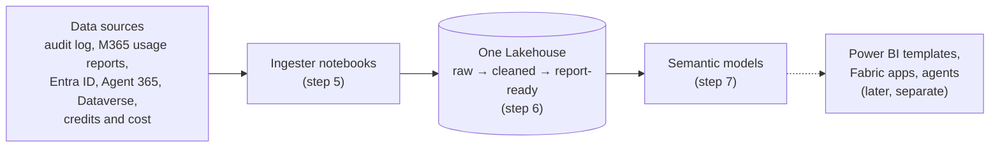

# Universal Data Lake for Microsoft 365 and Copilot data

Build **one Microsoft Fabric Lakehouse** that holds your Microsoft 365 Copilot data, your agent data, and how people use Teams, Outlook, Word, Excel, PowerPoint, OneNote, SharePoint, OneDrive and Viva Engage. The data is cleaned and shaped into report-ready tables, and **semantic models** sit on top, ready for Power BI, Copilot in Power BI, data agents or your own SQL.

You do each step yourself, so when something fails you can see which step, which source and which dates, and re-run just that.

**You end up with**

* one Lakehouse with all the data, refreshed daily;
* semantic models with relationships and measures, ready to report on;
* a log of every step and every date range loaded.

**What it opens up.** The lake is the foundation. Once it exists you can connect **Power BI report templates** to its semantic models, and build **Fabric apps** on it, without collecting the data again. Those are separate deployments; this repo builds the lake and the models only.



## Disclaimer

> [!IMPORTANT]
> **This is not the official Copilot report.** The official sources for Copilot usage reporting are the **Microsoft 365 admin center** (Copilot usage reports) and **Viva Insights** (Copilot Dashboard). This lake builds its Copilot figures from the Purview audit log, which is not the authoritative source for usage reporting. Its numbers may not always match the official reports exactly.
>
> **You are responsible for the data once it is extracted.** Retention, deletion and other policies set in the source systems (Purview, Microsoft 365, Entra ID, Dataverse and others) do not apply to the copies this lake makes. It is up to you to manage the extracted data and comply with the requirements that apply to your organisation.

## What you need

| | Minimum |
|---|---|
| Fabric capacity | **F2**, or a free Fabric trial. **F64+** for more than ~10,000 people or for viewers without Power BI Pro. See [step 1](01-fabric/README.md#11-pick-a-capacity). |
| Fabric workspace | One, where you are **Admin** or **Member** |
| Entra ID | Rights to register an app, and an admin who can grant consent |
| Azure Key Vault | **Recommended** for the app's secret. No vault yet? You can put the secret in `config.json` for a first run (not recommended; see [step 2.2](02-permissions/README.md#22-store-the-client-secret)). |
| A PC with | Git, Node.js 20.12+, Python 3.9+ (see [Before you start](#before-you-start)) |

## Before you start

Do these two things first. Every later step writes a value into `config.json`, so you need it from the start.

**1. Get the code.** Install Git, **Node.js 20.12+** and **Python 3.9+** (check with `git --version`, `node --version`, `python --version`). Then clone this repo (its URL is under **Code > Clone** at the top of its GitHub page). Everything it needs is inside; there's nothing else to download.

```powershell
git clone <this-repo-url> UniversalLake
cd UniversalLake
copy config.template.json config.json
```

`config.json` is git-ignored, so your IDs never get committed. There's no `npm install`: the build uses only Node.js and Python. If `npm` is blocked on your PC (e.g. a Microsoft-managed device), see [If `npm run all` doesn't work](03-configure/README.md#if-npm-run-all-doesnt-work). Each setting has a `//` comment explaining what it is, where to find it and when you can leave it alone. The comments are allowed and you can leave them in (your editor may underline them; that's fine).

**2. Choose your data sources.** Read the [data sources table](#data-sources) and, in `config.json` under `dataSources`, set each one to `api`, `csv` or `skip` ([what these mean](03-configure/README.md#31-finish-configjson)). This decides which permissions the app needs in step 2 and which export files you'll need. Start small if you like: `copilotInteractions` and `orgData` are required, and you can turn others on later.

* **`skip`** leaves the source out, and you can ignore its settings: `azure` is only read when `azureAi` is `api`, and `dataverseEnvironments` only when `agentEvaluator` is `api`.
* **`csv`**: **download the export now and save it on your PC.** That's all for now: you don't create any folders. `Lake_Init` creates a Lakehouse folder for each source in [step 4.3](04-import/README.md), and you upload the files there in [step 4.6](04-import/README.md#46-upload-csv-exports-only-sources-set-to-csv). Where each export comes from is in the [data sources table](#data-sources). No file yet? Use `skip`, or keep `csv`: the run still finishes, but that source's tables stay empty until you upload.

## Steps

Do them in order. Each folder's README has the exact clicks.

| Step | You do | Where |
|---|---|---|
| [1. Fabric](01-fabric/README.md) | Create the workspace and a **schema-enabled** Lakehouse, copy their IDs into `config.json` | Fabric portal |
| [2. Permissions](02-permissions/README.md) | Register the app, store its secret, give it access, **confirm the checklist** | Entra, Microsoft 365 admin, Azure portals |
| [3. Configure](03-configure/README.md) | Check `config.json` is complete, run `npm run all` to generate the notebooks and model files | Your PC |
| [4. Import](04-import/README.md) | Import the notebooks, run `Lake_Init` and `Lake_Validate_Credentials`, upload the model files | Fabric |
| [5. Ingest](05-ingest/README.md) | Run `Lake_Orchestrator` once with `first_load`: all ingesters, the first backfill, processing and promote | Fabric |
| [6. Process](06-process/README.md) | Check that the data was cleaned and sorted into report-ready tables | Fabric |
| [7. Semantic models](07-semantic-model/README.md) | Create, connect and refresh the models | Fabric |
| [8. Orchestrate](08-orchestrate/README.md) | Schedule the daily run, [re-run only what failed](08-orchestrate/RERUNS.md) | Fabric |

**Backfill.** The first run loads 30 days of audit history by default (up to 180). Daily runs then pick up where the last one stopped. Every date range loaded is recorded in `ops.backfill_ledger`.

## Data sources

**Copilot interactions** and **Org data** are required. Pick the others before step 2 (see [Before you start](#before-you-start)), because they decide the app's permissions. You can add more later. The tables each one creates are listed in [step 6](06-process/README.md).

| Source (`config.json` name) | What you get | Needs |
|---|---|---|
| **Copilot interactions**<br/>`copilotInteractions` | Every Copilot prompt and agent run, from the Purview audit log, plus who has a Copilot licence | Graph `AuditLogsQuery.Read.All`, `Reports.Read.All` |
| **Org data**<br/>`orgData` | Department, job title, country and manager for each person, from Entra ID | Graph `User.Read.All` |
| **M365 activity**<br/>`m365Activity` | Daily use of Teams, Outlook, Word, Excel, PowerPoint, OneNote, SharePoint, OneDrive and Viva Engage | Graph `Reports.Read.All` |
| **Agent 365**<br/>`agent365` | Every agent in the tenant, with its publisher, status and owners | Graph `CopilotPackages.Read.All`, `Application.Read.All` (or a CSV export) |
| **Product feedback**<br/>`productFeedback` | Copilot thumbs up and down, with comments | CSV from Microsoft 365 admin center > **Health > Product feedback > Export**.<br/>Role: Global Administrator or Reports Reader |
| **Agent evaluator**<br/>`agentEvaluator` | Copilot Studio conversation transcripts, from Dataverse | No CSV; read directly from Dataverse. A Power Platform Administrator adds the app as an application user with **Bot Transcript Viewer** (Power Platform admin center) |
| **Consumption**<br/>`consumption` | Copilot Studio and Copilot credits, Azure AI cost and tokens | **Studio credits:** CSV from Power Platform admin center > **Licensing > Copilot Studio**. Role: Power Platform Administrator<br/>**Copilot credits:** CSV from Viva Insights > **Copilot Consumption Dashboard > Export**. Role: Insights Analyst<br/>**Azure AI:** no CSV. A subscription Owner gives the app Reader, Cost Management Reader and Monitoring Reader on the subscription ([2.4](02-permissions/README.md#24-azure-ai-access-only-if-azureai-is-api)) |

## What ends up in the Lakehouse

You don't need to know these to use the lake, but you'll see them as folders (schemas) in the Lakehouse. Data moves left to right: raw, then cleaned, then report-ready.

| Folder | What's in it | Do you use it? |
|---|---|---|
| `gold` | The report-ready tables. The semantic models read only these. | **Yes.** Point reports, apps and SQL here. |
| `silver` | Cleaned data and history the models don't read | Rarely |
| `bronze` | Raw data as it arrived, and logs | Only to troubleshoot |
| `ops` | Settings, the run log, and which dates have been loaded | To check runs |
| `dbo` | The notebooks' working tables | No. Leave them alone; each daily load reads its own previous output. |

## How the ingesters work

They ask Microsoft's APIs for data a few requests at a time, stay within Purview's audit search limits, and save each finished piece, so a stopped run carries on where it left off. Spark then unpacks all the nested records at once across the cluster and updates the tables in place, so re-runs never create duplicates. Details: [ARCHITECTURE.md](ARCHITECTURE.md).

## Where the notebook code comes from

Everything is in this repo. `notebooks/` holds the ingester and processor notebooks, `models/` the semantic model definitions (`.bim`), and `scripts/build/` the code that fills in your settings. `npm run all` turns them into the files you import. The `Lake_*` notebooks (sources in `notebook-src/`) set up the Lakehouse, check credentials, sort tables into layers, deploy the models and run everything in order.

To take a newer version of this repo: `git pull`, run `npm run all`, re-import what it says changed ([step 4](04-import/README.md#re-building-later)), then run `Lake_Deploy_Models` and `Lake_Orchestrator`.

## Keeping IDs and secrets out of the repo

Your IDs (and the secret, if you use the bypass) go only in `config.json` and `out/`, which are git-ignored. `npm run scan` fails if a file that would be committed has a GUID, a secret or key, a personal path or email, a notebook with outputs or a Lakehouse binding, or any term you list in `.scan-blocklist` (git-ignored). Run `git config core.hooksPath .githooks` once to scan before every commit; CI runs the same scan on every push.

## Repository layout

```
01-fabric/ … 08-orchestrate/   one folder per step: README plus that step's notebook or script
config.template.json           copy to config.json (git-ignored)
scripts/                       generate notebooks and models (scripts/build/); scan for secrets
notebooks/                     ingester and processor notebook templates
models/                        semantic model definitions (.bim)
notebook-src/                  readable sources of the Lake_* notebooks
out/                           generated, git-ignored: what you import into Fabric
```
