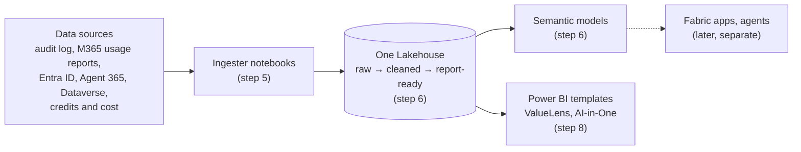

# Universal Data Lake for Microsoft 365 and Copilot data

Build **one Microsoft Fabric Lakehouse** that holds your Microsoft 365 Copilot data, your agent data, and how people use Teams, Outlook, Word, Excel, PowerPoint, OneNote, SharePoint, OneDrive and Viva Engage. The data is cleaned and shaped into report-ready tables, and **semantic models** sit on top, ready for Power BI, Copilot in Power BI, data agents or your own SQL.

**Why bother?** Most Copilot and Microsoft 365 reports each collect their own copy of the data, so every new report means setting up the same sources, permissions and refreshes again. Build the lake once and that stops:

* **Plug in our Power BI templates** without repeating the setup for each report. They all read the same Lakehouse ([templates](08-report-templates/README.md)).
* **Build your own analytics and observability foundation.** All the data sits in one place you own, ready for your own reports, Fabric apps, data agents or plain SQL.
* **Know exactly what's going on.** Every step is a notebook you can open, read, change and rerun, so you can customise what's collected and how it's shaped.

**Fair warning: this is flat-pack furniture.** Setting it up feels a lot like assembling an IKEA wardrobe. You unbox everything, lay the parts out on the floor, find the tools (the Allen key is in here somewhere), do step one, then flip to the manual for step two. Repeat. There's no "install" button, and at some point you'll be convinced a part is missing (it isn't; check [Troubleshooting](TROUBLESHOOTING.md)).

The payoff: when it is done, you know exactly how this is put together. If a step goes wrong, you don't have to take the whole thing apart. You can see which step, which cell, which source and which dates failed, and redo just that one.



## Disclaimer

> [!IMPORTANT]
> **This is not the official Copilot report.** The official sources for Copilot usage reporting are the **Microsoft 365 admin center** (Copilot usage reports) and **Viva Insights** (Copilot Dashboard). This lake builds its Copilot figures from the Purview audit log, which is not the authoritative source for usage reporting. Its numbers may not always match the official reports exactly.
>
> **You are responsible for the data once it is extracted.** Retention, deletion and other policies set in the source systems (Purview, Microsoft 365, Entra ID, Dataverse and others) do not apply to the copies this lake makes. It is up to you to manage the extracted data and comply with the requirements that apply to your organisation.

## What you need

| | Minimum |
|---|---|
| Fabric capacity | **F2**, or a free Fabric trial. **F64+** for more than ~10,000 people or for viewers without Power BI Pro. See [step 1](01-fabric/README.md#11-pick-a-capacity). |
| Fabric workspace | One, where you are **Contributor** or above. Deploy creates the Lakehouse in it. |
| Entra ID | Rights to register an app, and an admin who can grant consent |
| Azure Key Vault | **Recommended** for the app's secret. No vault yet? You can put the secret in `config.json` for a first run (not recommended; see [step 2.2](02-permissions/README.md#22-store-the-client-secret)). |
| A PC with | Git, Node.js 20.12+, Python 3.9+ (see [Before you start](#before-you-start)) |

## Before you start

**How it fits together.** All your settings go in one file, `config.json`. **You don't fill it in now**: you don't have the values yet. Steps 1 to 4 produce them, and each step tells you which line to set:

| Step | What you create | What goes into `config.json` |
|---|---|---|
| 1 | A Fabric workspace | Its name |
| 2 | An app registration with permissions | Its IDs and secret (or Key Vault) |
| 3 | Your choice of data sources, and a folder of CSV exports | `api`, `csv` or `skip` for each, and the folder |
| 4 | `npm run deploy` creates the Lakehouse and sets everything up | Deploy fills in the workspace and Lakehouse IDs itself |

**Where the data comes from.** The lake gets data in two ways:

* **APIs:** the app you register in step 2 pulls it automatically, every day. No files to handle.
* **CSV exports:** a few sources (product feedback, Copilot Studio credits, Viva Copilot credits) have no API, so someone **exports them from an admin portal**. You save them in one folder and deploy uploads them.

**1. Get the code.** Install Git, **Node.js 20.12+** and **Python 3.9+** (check with `git --version`, `node --version`, `python --version`). Then get the code and make your own settings file:

```powershell
git clone https://github.com/microsoft/universal-lake.git
cd universal-lake
copy config.template.json config.json
```

You fill in `config.json` in step 3; it stays on your PC. If `npm` is blocked on your PC, see [If `npm` doesn't work](03-configure/README.md#if-npm-doesnt-work).

**2. Decide which sources you want.** Look at the [data sources table](#data-sources). `copilotInteractions` and `orgData` are required; start with those and add others later if you like. Your choice decides the app's permissions in step 2, so make it now (you write it into `config.json` in step 3).

**3. Start the CSV exports now (only for CSV sources you want).** They need admin roles you may not have, so ask early:

* Find the role for each export in the [data sources table](#data-sources) and ask whoever has it.
* Save **all the exported files in one folder on your PC**, outside this repo (for example `Documents\universal-lake-exports`). Subfolders are fine. In step 3 you put this folder in `config.json` as `exportsFolder`; deploy recognises each file by its columns and uploads it.
* [Which Studio and Viva files](03-configure/README.md#studio-and-viva-which-files).
* Can't get a file yet? You can still build the lake; that source's tables stay empty until you add it and deploy again.

## Steps

Steps 1–3 are set up in portals. After that, **the terminal does almost everything**: two commands replace steps 4–7. Every step can also be done by hand in Fabric if you prefer; each folder's README covers both ways. If something goes wrong, see [TROUBLESHOOTING.md](TROUBLESHOOTING.md).

| Step | From the terminal (fewest steps) | Or by hand |
|---|---|---|
| [1. Fabric](01-fabric/README.md) | – | Pick a capacity, create the workspace, put its name in `config.json` (Fabric portal) |
| [2. Permissions](02-permissions/README.md) | `setup-app.ps1` (needs Azure CLI) | Register the app, store its secret, give it access, **confirm the checklist** (Entra, Microsoft 365 admin, Azure portals) |
| [3. Configure](03-configure/README.md) | – | Finish `config.json`: data sources and your exports folder |
| [4. Deploy](04-deploy/README.md)<br/>[5. Ingest](05-ingest/README.md)<br/>[6. Models](06-models/README.md) | **`npm run deploy -- --run first_load`**<br/>Creates the Lakehouse, uploads everything, checks setup, then loads the data and builds the models. Prints the model links when done. | `npm run deploy`, then in Fabric open `Lake_Orchestrator`, set `RUN_MODE = 'first_load'`, **Run all** |
| [7. Orchestrate](07-orchestrate/README.md)<br/>[9. Auto-refresh](09-autorefresh/README.md) | **`npm run deploy -- --schedule 06:00`**<br/>Daily refresh. Re-run what failed: `npm run deploy -- --rerun-failed` | Schedule `Lake_Orchestrator` in Fabric; [re-run only what failed](07-orchestrate/RERUNS.md) |
| [8. Reports](08-report-templates/README.md) | – | Open the ValueLens or AI-in-One template in Power BI Desktop, point it at the Lakehouse, publish |

Then do the one-time [set-and-forget checklist](09-autorefresh/README.md) so daily runs need no attention.

**Backfill.** The first run loads 30 days of audit history by default (up to 180). Daily runs then pick up where the last one stopped. Every date range loaded is recorded in `ops.backfill_ledger`.

## Data sources

**Copilot interactions** and **Org data** are required; the rest are optional. The tables each one creates are listed in [step 6](06-models/README.md).

| Source (`config.json` name) | What you get | Needs |
|---|---|---|
| **Copilot interactions**<br/>`copilotInteractions` | Every Copilot prompt and agent run, from the Purview audit log, plus who has a Copilot licence | Graph `AuditLogsQuery.Read.All`, `Reports.Read.All` |
| **Org data**<br/>`orgData` | Department, job title, country and manager for each person, from Entra ID | Graph `User.Read.All` |
| **M365 activity**<br/>`m365Activity` | Daily use of Teams, Outlook, Word, Excel, PowerPoint, OneNote, SharePoint, OneDrive and Viva Engage | Graph `Reports.Read.All` |
| **Agent 365**<br/>`agent365` | Every agent in the tenant, with its publisher, status and owners | Graph `CopilotPackages.Read.All`, `Application.Read.All` (or a CSV export) |
| **Product feedback**<br/>`productFeedback` | Copilot thumbs up and down, with comments | CSV from Microsoft 365 admin center > **Health > Product feedback > Export**.<br/>Role: Global Administrator or Reports Reader |
| **Agent evaluator**<br/>`agentEvaluator` | Copilot Studio conversation transcripts, from Dataverse | No CSV; read directly from Dataverse. A Power Platform Administrator adds the app as an application user with **Bot Transcript Viewer** (Power Platform admin center) |
| **Consumption**<br/>`consumption` | Copilot Studio and Copilot credits, Azure AI cost and tokens | **Studio credits:** CSVs from Power Platform admin center > **Licensing > Copilot Studio** (tenant, per-agent and per-user reports; [which files](03-configure/README.md#studio-and-viva-which-files)). Role: Power Platform Administrator<br/>**Copilot credits:** CSVs from Viva Insights > **Copilot Consumption Dashboard > Export** (`PersonServiceCreditsMetrics` and `SpendingPolicyMetadata`). Role: Insights Analyst<br/>**Azure AI:** no CSV. A subscription Owner gives the app Reader, Cost Management Reader and Monitoring Reader on the subscription ([2.4](02-permissions/README.md#24-azure-ai-access-only-if-azureai-is-api)) |

## How it works

Not needed to set it up. If you're curious what's in the Lakehouse, how the ingesters collect data, or where the code lives, see [How it works](ARCHITECTURE.md).

## Trademarks

This project may contain trademarks or logos for projects, products, or services. Authorized use of Microsoft
trademarks or logos is subject to and must follow
[Microsoft's Trademark & Brand Guidelines](https://www.microsoft.com/legal/intellectualproperty/trademarks/usage/general).
Use of Microsoft trademarks or logos in modified versions of this project must not cause confusion or imply Microsoft sponsorship.
Any use of third-party trademarks or logos are subject to those third-party's policies.
