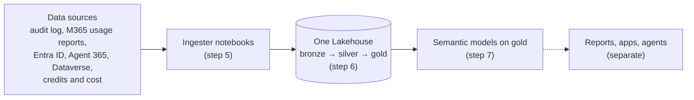

# Universal Data Lake for Microsoft 365 and Copilot data

Build **one Microsoft Fabric Lakehouse** that holds your Microsoft 365 Copilot data, your agent data, and how people use Teams, Outlook, Word, Excel, PowerPoint, OneNote, SharePoint, OneDrive and Viva Engage. The data lands in **bronze, silver and gold** layers, and **semantic models** sit on gold, ready for Power BI, Copilot in Power BI, data agents or your own SQL.

You do each step yourself, so when something fails you can see which step, which source and which dates, and re-run just that.

**You end up with**

* a Lakehouse with `bronze`, `silver`, `gold` and `ops` schemas;
* semantic models on the gold tables, with relationships and measures;
* a daily refresh, and a log of every step and every date range loaded.

**Not included:** reports or a Fabric app. A Fabric app with reports is a separate deployment that can point at this lake.



## What you need

| | Minimum |
|---|---|
| Fabric capacity | **F2**, or a free Fabric trial. **F64+** for more than ~10,000 people or for viewers without Power BI Pro. See [step 1](01-fabric/README.md#11-pick-a-capacity). |
| Fabric workspace | One, where you are **Admin** or **Member** |
| Entra ID | Rights to register an app, and an admin who can grant consent |
| Azure Key Vault | **Recommended** for the app's secret. No vault yet? You can put the secret in `config.json` for a first run (not recommended; see [step 2.2](02-permissions/README.md#22-store-the-client-secret)). |
| A PC with | Git, Node.js 20.12+, Python 3.9+ |

## Steps

Do them in order. Each folder's README has the exact clicks.

| Step | You do | Where |
|---|---|---|
| [1. Fabric](01-fabric/README.md) | Create the workspace and a **schema-enabled** Lakehouse, copy their IDs from the URL | Fabric portal |
| [2. Permissions](02-permissions/README.md) | Register the app, store its secret, give it access, **confirm the checklist** | Entra, Fabric admin, Azure portals |
| [3. Configure](03-configure/README.md) | Fill in `config.json`, run `npm run all` to generate the notebooks and model files | Your PC |
| [4. Import](04-import/README.md) | Import the notebooks, run `Lake_Init` and `Lake_Validate_Credentials`, upload the model files | Fabric |
| [5. Ingest](05-ingest/README.md) | Run `Lake_Orchestrator` once with `first_load`: all ingesters, the first backfill, processing and promote | Fabric |
| [6. Process](06-process/README.md) | Check what the processor and promote did (bronze, silver, gold) | Fabric |
| [7. Semantic models](07-semantic-model/README.md) | Create, connect and refresh the models | Fabric |
| [8. Orchestrate](08-orchestrate/README.md) | Schedule the daily run, [re-run only what failed](08-orchestrate/RERUNS.md) | Fabric |

**Backfill.** The first run loads 30 days of audit history by default (up to 180). Daily runs then pick up where the last one stopped. Every date range loaded is recorded in `ops.backfill_ledger`.

## Data sources

Only `copilotInteractions` is required. Turn the others on in `config.json` (step 3); you can add them later.

| Module | Data | Gold table(s) | Needs |
|---|---|---|---|
| `copilotInteractions` | Every Copilot prompt and agent run (Purview audit log); who has a Copilot licence | `copilot_interactions_curated`, `copilot_licensed_users` | Graph `AuditLogsQuery.Read.All`, `Reports.Read.All` |
| `orgData` | Department, job title, country, manager (Entra ID) | `copilot_org_data` | Graph `User.Read.All` |
| `m365Activity` | Daily use of Teams, Outlook, Word, Excel, PowerPoint, OneNote, SharePoint, OneDrive, Viva Engage | `m365_activity_daily` | Graph `Reports.Read.All` |
| `agent365` | Agents in the tenant: publisher, status, owners | `agents_365` | Graph `CopilotPackages.Read.All`, `Application.Read.All`, or a CSV export |
| `productFeedback` | Copilot thumbs up/down and comments | `user_feedback` | CSV export |
| `agentEvaluator` | Copilot Studio transcripts (Dataverse) | `agent_sessions`, `agent_turns`, … | App added as a Dataverse application user |
| `consumption` | Copilot Studio and Copilot credits, Azure AI cost and tokens | `studio_*`, `viva_*`, `azure_*` | CSV exports; Azure reader roles for Azure AI |

## What ends up in the Lakehouse

| Schema | Contents |
|---|---|
| `dbo` | The ingesters' working tables. Leave them alone; each daily load reads its own previous output. |
| `bronze` | Raw extracts and logs |
| `silver` | Cleaned and history tables no model reads |
| `gold` | Exactly the tables the semantic models read |
| `ops` | Settings, run log, backfill ledger, which layer each table went to |

## How the ingesters work

They fetch from Microsoft in parallel (several Purview audit queries and Graph reports at once, backing off when throttled) and save each finished window, so a failed run resumes instead of starting over. Spark then parses and flattens the nested JSON column-wise across the cluster, not row by row, and writes Delta with `MERGE` on stable keys, so reruns never duplicate. Details: [ARCHITECTURE.md](ARCHITECTURE.md).

## Where the notebook code comes from

The ingesters, processor and model definitions are not written here. `npm run all` generates them from a fixed commit of the open-source [ValueLens for Microsoft Copilot](https://github.com/microsoft/ValueLens-for-Microsoft-Copilot) Fabric installer, so the extract logic is the same tested code. This repo adds the `Lake_*` notebooks that set up the Lakehouse, check credentials, sort tables into layers, deploy the models and run everything in order.

To take a newer version: pull the source repo, set `pinnedCommit` in `config.json`, run `npm run all`, re-import what it says changed ([step 4](04-import/README.md#re-building-later)), then run `Lake_Deploy_Models` and `Lake_Orchestrator`.

## Keeping IDs and secrets out of the repo

Your IDs (and the secret, if you use the bypass) go only in `config.json` and `out/`, which are git-ignored. `npm run scan` fails if a file that would be committed has a GUID, a secret or key, a personal path or email, a notebook with outputs or a Lakehouse binding, or any term you list in `.scan-blocklist` (git-ignored). Run `git config core.hooksPath .githooks` once to scan before every commit; CI runs the same scan on every push.

## Repository layout

```
01-fabric/ … 08-orchestrate/   one folder per step: README plus that step's notebook or script
config.template.json           copy to config.json (git-ignored)
scripts/                       generate notebooks and models; scan for secrets
notebook-src/                  readable sources of the Lake_* notebooks
out/                           generated, git-ignored: what you import into Fabric
```
