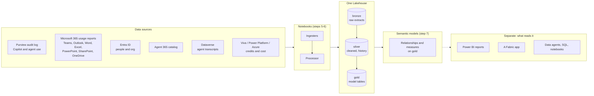
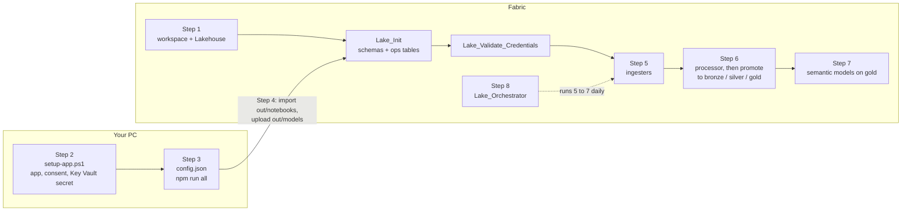
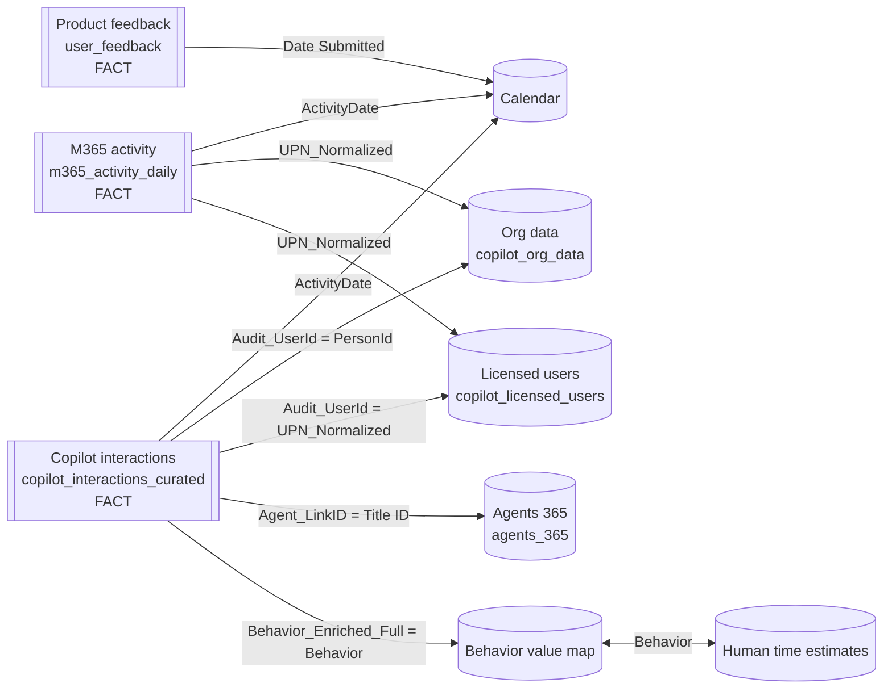

# Universal Data Lake for Microsoft 365 and Copilot data

This repo walks you through building **one Microsoft Fabric Lakehouse** that holds your Microsoft 365 Copilot data, your agent data, and how people use the Microsoft 365 apps (Teams, Outlook, Word, Excel, PowerPoint, OneNote, SharePoint, OneDrive, Viva Engage). The data lands in **bronze, silver and gold** layers, and **semantic models** sit on the gold layer, ready for Power BI reports, Copilot in Power BI, data agents or your own analysis.

**What you get at the end:**

* a Lakehouse with `bronze`, `silver`, `gold` and `ops` schemas, filled with data from the APIs and exports you switch on;
* semantic models on the `gold` tables, with relationships and measures already defined;
* a daily refresh you can schedule, and a log of every step and every backfill window.

**What this repo doesn't do:** build reports or publish a Fabric app. A Fabric app (for example the ValueLens app) is a **separate deployment** that can point at this lake and its models. This repo stops at the lake and the semantic models.

You do every step yourself, in the Fabric portal and with a few scripts on your PC, so when something fails you can see exactly which step, which data source and which date range, and re-run only that.

## The idea: pull once, model once, use everywhere

Every source lands in one Lakehouse and sits behind one set of models. Every report, app or agent reads the same tables, so nobody re-pulls the APIs for a new question. Only the Copilot audit feed is required; every other source is optional, and you can turn it on later.



## What you need in Fabric

| | Minimum | Notes |
|---|---|---|
| Capacity | **F2**, or a Fabric trial (60 days, F64-sized) | The notebooks run on any F SKU. Use **F64 or larger** above about 10,000 people, or if report viewers don't have Power BI Pro. Below F64, everyone who opens a report needs Pro or PPU. Details in [step 1](01-fabric/README.md#11-pick-a-capacity). |
| Workspace | One, on that capacity | You need **Admin** or **Member** on it. |
| Lakehouse | One, with **Lakehouse schemas** ticked | Schemas can't be turned on afterwards. |
| Azure | A Key Vault, and rights to create an app registration | Holds the app's client secret. The notebooks read it at run time. |
| Microsoft 365 | Audit logging on, and an admin who can grant consent | The full list is in [step 2](02-permissions/README.md). |

## Steps

Follow them in order. Each folder has a README with exact clicks, what you should see, and what usually goes wrong.

| Step | Folder | You do | Where |
|---|---|---|---|
| 1 | [`01-fabric`](01-fabric/README.md) | Pick a capacity, create the workspace and a **schema-enabled** Lakehouse, note three IDs | Fabric portal |
| 2 | [`02-permissions`](02-permissions/README.md) | Choose your data sources, set tenant settings, create the app registration, then **confirm every permission** with the checklist | Admin portals, `setup-app.ps1` |
| 3 | [`03-configure`](03-configure/README.md) | Clone the code, fill in `config.json`, run `npm run all` to build the notebooks and model files | Your PC |
| 4 | [`04-import`](04-import/README.md) | Import the notebooks, upload the model files and CSV exports, run `Lake_Init` and `Lake_Validate_Credentials` | Fabric |
| 5 | [`05-ingest`](05-ingest/README.md) | Run the ingesters, one at a time the first time, with the backfill you choose | Fabric notebooks |
| 6 | [`06-process`](06-process/README.md) | Run the audit processor, then promote the tables into bronze, silver and gold | Fabric notebooks |
| 7 | [`07-semantic-model`](07-semantic-model/README.md) | Create the semantic models on gold, connect them, refresh them and check row counts | `Lake_Deploy_Models` |
| 8 | [`08-orchestrate`](08-orchestrate/README.md) | Run everything in order from one notebook, schedule it, and [re-run only what failed](08-orchestrate/RERUNS.md) | `Lake_Orchestrator` |



### Backfills and re-runs

The first load pulls history: by default 30 days of the audit log (up to 180), plus whatever history each other source offers. After that, each daily run picks up where the last one stopped. `Lake_Orchestrator` prints the plan (which steps, which dates) before it runs anything, records every date window it loaded in `ops.backfill_ledger`, and can re-run only the steps that failed. See [step 5](05-ingest/README.md) and [re-runs](08-orchestrate/RERUNS.md).

## Data sources

The module name is what you set in `config.json` → `dataSources` and pass to `setup-app.ps1 -Modules`.

| Source | What it holds | Gold table | Access needed | Module |
|---|---|---|---|---|
| Copilot interactions (Purview audit log) | Every Copilot prompt and agent run: user, app, time, files and sites touched | `copilot_interactions_curated` | `AuditLogsQuery.Read.All` | `core` (required) |
| Licensed users (Microsoft 365 usage reports) | Who holds a Copilot licence, last activity per app | `copilot_licensed_users` | `Reports.Read.All` | `core` (required) |
| Org data (Entra ID) | Department, job title, country, manager chain | `copilot_org_data` | `User.Read.All` | `orgData` |
| Microsoft 365 app usage (6 usage reports) | Daily activity per person in Teams, Outlook and email, Word, Excel, PowerPoint, OneNote, SharePoint, OneDrive and Viva Engage | `m365_activity_daily` | `Reports.Read.All` | `m365Activity` |
| Agent 365 (agent registry) | Agents in the tenant: publisher, status, owners | `agents_365` | `CopilotPackages.Read.All`, `Application.Read.All` (or a CSV export) | `agent365` |
| Product feedback | Thumbs up and down, and comments on Copilot | `user_feedback` | CSV export, no API permission | `productFeedback` |
| Copilot Studio transcripts (Dataverse) | Sessions, turns, errors and knowledge use per agent | `agent_sessions`, `agent_turns`, … | App added as a Dataverse application user | `agentEvaluator` |
| Copilot Studio credits (Power Platform admin center) | Credits by environment, agent and user | `studio_*` | CSV export | `studioCredits` |
| Copilot credits (Viva Insights) | Credits per person, spending policies | `viva_credits_weekly`, … | CSV export | `coworkCredits` |
| Azure AI cost (Cost Management, Monitor) | Daily AI spend and tokens | `azure_ai_spend`, `azure_ai_tokens` | Cost Management Reader, Monitoring Reader | `azureAi` |

Two settings cause most bad first runs:

* **Concealed user names.** If *Microsoft 365 admin center → Settings → Org settings → Reports* hides names, the usage reports return random IDs instead of user names, and nothing joins. Turn it off before the first run ([step 2.3](02-permissions/README.md#23-tenant-settings)).
* **Blank Entra fields.** An empty department or manager in Entra ID shows up as a blank in every org slicer.

## What is in the Lakehouse afterwards

| Schema | Contents |
|---|---|
| `dbo` | The ingesters' working tables. Leave them alone: each daily load reads its own previous output from here. |
| `bronze` | Raw extracts and logs, such as `copilot_interactions_parsed`, `*_raw`, upload and load logs |
| `silver` | Cleaned intermediate and history tables that no model reads |
| `gold` | Exactly the tables the semantic models read |
| `ops` | `config`, `run_log` (one row per step per run), `backfill_ledger` (every date window loaded), `table_layers` (which layer each table went to) |

### How the gold tables join

The main model is a star. Copilot interactions and Microsoft 365 activity are the two fact tables, and they share the person and date dimensions. The person key everywhere is the lower-cased user principal name (UPN).



Things to know when a number looks wrong:

* **Guests and service accounts** have no org row, so they show as unmapped.
* **Licences are a current snapshot**, not history, so licence trends need a daily snapshot.
* **Agent IDs in the audit log don't match the catalog directly.** The processor builds `Agent_LinkID` by trying the Entra ID, then the title ID, then the agent name.
* **There is no relationship between the two facts.** Measures bridge them on person and date.

## Where the notebook code comes from

The ingesters, processor and model definitions aren't written from scratch here. `npm run all` (step 3) copies them from a fixed commit of the open-source [ValueLens for Microsoft Copilot](https://github.com/microsoft/ValueLens-for-Microsoft-Copilot) Fabric installer, so the extract logic is the same tested code. This repo adds the notebooks that set up the Lakehouse, check credentials, sort tables into layers, deploy the models and run everything in order (the `Lake_*` notebooks).

To take a newer version of that code:

1. Pull your clone of the source repo.
2. Set `pinnedCommit` in `config.json` to the new commit, then run `npm run all`. It tells you which notebooks changed, and stops if a model definition changed shape.
3. Re-import the changed notebooks and re-upload `out/models` ([step 4](04-import/README.md#re-building-later)).
4. Run `Lake_Deploy_Models` (it updates the models in place) and then `Lake_Orchestrator`.

## Keeping IDs, secrets and personal details out of the repo

Your tenant ID, client ID, workspace and Lakehouse IDs belong only in `config.json`, which is git-ignored. The client secret lives only in Key Vault. `scripts/scan_sensitive.mjs` fails if anything that would be committed contains:

* a GUID (tenant, client, workspace or object ID), except public IDs such as Microsoft Graph's
* a client secret, password, storage key, SAS signature, private key, JWT or GitHub token
* a personal path (`C:\Users\<name>`, `/home/<name>`), an email address, a personal OneDrive or SharePoint link, or a tenant `*.onmicrosoft.com` domain
* a notebook with saved outputs or a Lakehouse binding
* any term you list in `.scan-blocklist`, such as your alias or tenant name (one per line; this file is git-ignored)

It runs in three places:

```powershell
git config core.hooksPath .githooks   # once per clone: scans staged files before every commit
npm run scan                          # whole repo plus commit author emails (must be GitHub noreply)
```

The `sensitive-content-scan` GitHub Actions workflow runs the same check on every push and pull request.

## Repository layout

```
01-fabric/ ... 08-orchestrate/   one folder per step: README plus that step's script or notebook
config.template.json             copy to config.json (git-ignored); no secrets in it
scripts/                         build scripts (check_source, sync_notebooks, build_models, build_ipynb)
                                 and scan_sensitive
notebook-src/                    readable sources of the Lake_* notebooks, built into the step folders
.githooks/, .github/             pre-commit hook and CI workflow that run scan_sensitive
out/                             generated, git-ignored: notebooks to import, model files, SOURCE.lock.json
```
