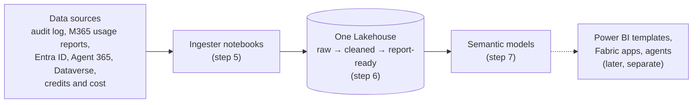

# Universal Data Lake for Microsoft 365 and Copilot data

Build **one Microsoft Fabric Lakehouse** that holds your Microsoft 365 Copilot data, your agent data, and how people use Teams, Outlook, Word, Excel, PowerPoint, OneNote, SharePoint, OneDrive and Viva Engage. The data is cleaned and shaped into report-ready tables, and **semantic models** sit on top, ready for Power BI, Copilot in Power BI, data agents or your own SQL.

You do each step yourself, so when something fails you can see which step, which source and which dates, and re-run just that.

**You end up with**

* one Lakehouse with all the data, refreshed daily;
* semantic models with relationships and measures, ready to report on;
* a log of every step and every date range loaded.

**What it opens up.** The lake is the foundation. Once it exists you can connect **Power BI report templates** to its semantic models, and build **Fabric apps** on it, without collecting the data again. Those are separate deployments; this repo builds the lake and the models only.



## What you need

| | Minimum |
|---|---|
| Fabric capacity | **F2**, or a free Fabric trial. **F64+** for more than ~10,000 people or for viewers without Power BI Pro. See [step 1](01-fabric/README.md#11-pick-a-capacity). |
| Fabric workspace | One, where you are **Admin** or **Member** |
| Entra ID | Rights to register an app, and an admin who can grant consent |
| Azure Key Vault | **Recommended** for the app's secret. No vault yet? You can put the secret in `config.json` for a first run (not recommended; see [step 2.2](02-permissions/README.md#22-store-the-client-secret)). |
| A PC with | Git, Node.js 20.12+, Python 3.9+ |

## Steps

Do them in order. Each folder's README has the exact clicks.

| Step | You do | Where |
|---|---|---|
| [1. Fabric](01-fabric/README.md) | Create the workspace and a **schema-enabled** Lakehouse, copy their IDs from the URL | Fabric portal |
| [2. Permissions](02-permissions/README.md) | Register the app, store its secret, give it access, **confirm the checklist** | Entra, Fabric admin, Azure portals |
| [3. Configure](03-configure/README.md) | Fill in `config.json`, run `npm run all` to generate the notebooks and model files | Your PC |
| [4. Import](04-import/README.md) | Import the notebooks, run `Lake_Init` and `Lake_Validate_Credentials`, upload the model files | Fabric |
| [5. Ingest](05-ingest/README.md) | Run `Lake_Orchestrator` once with `first_load`: all ingesters, the first backfill, processing and promote | Fabric |
| [6. Process](06-process/README.md) | Check that the data was cleaned and sorted into report-ready tables | Fabric |
| [7. Semantic models](07-semantic-model/README.md) | Create, connect and refresh the models | Fabric |
| [8. Orchestrate](08-orchestrate/README.md) | Schedule the daily run, [re-run only what failed](08-orchestrate/RERUNS.md) | Fabric |

**Backfill.** The first run loads 30 days of audit history by default (up to 180). Daily runs then pick up where the last one stopped. Every date range loaded is recorded in `ops.backfill_ledger`.

## Data sources

Only **Copilot interactions** is required. Turn the others on in `config.json` (step 3), now or later. The tables each one creates are listed in [step 6](06-process/README.md).

| Source (`config.json` name) | What you get | Needs |
|---|---|---|
| **Copilot interactions**<br/>`copilotInteractions` | Every Copilot prompt and agent run, from the Purview audit log, plus who has a Copilot licence | Graph `AuditLogsQuery.Read.All`, `Reports.Read.All` |
| **Org data**<br/>`orgData` | Department, job title, country and manager for each person, from Entra ID | Graph `User.Read.All` |
| **M365 activity**<br/>`m365Activity` | Daily use of Teams, Outlook, Word, Excel, PowerPoint, OneNote, SharePoint, OneDrive and Viva Engage | Graph `Reports.Read.All` |
| **Agent 365**<br/>`agent365` | Every agent in the tenant, with its publisher, status and owners | Graph `CopilotPackages.Read.All`, `Application.Read.All` (or a CSV export) |
| **Product feedback**<br/>`productFeedback` | Copilot thumbs up and down, with comments | CSV export |
| **Agent evaluator**<br/>`agentEvaluator` | Copilot Studio conversation transcripts, from Dataverse | App added as a Dataverse application user |
| **Consumption**<br/>`consumption` | Copilot Studio and Copilot credits, Azure AI cost and tokens | CSV exports; Azure reader roles for Azure AI |

## What ends up in the Lakehouse

You don't need to know these to use the lake, but you'll see them as folders (schemas) in the Lakehouse. Data moves left to right: raw, then cleaned, then report-ready.

| Folder | What's in it | Do you use it? |
|---|---|---|
| `gold` | The report-ready tables. The semantic models read only these. | **Yes.** Point reports, apps and SQL here. |
| `silver` | Cleaned data and history the models don't read | Rarely |
| `bronze` | Raw data as it arrived, and logs | Only to troubleshoot |
| `ops` | Settings, the run log, and which dates have been loaded | To check runs |
| `dbo` | The notebooks' working tables | No. Leave them alone; each daily load reads its own previous output. |

## How the ingesters work

They ask Microsoft's APIs for data a few requests at a time, stay within Purview's audit search limits, and save each finished piece, so a stopped run carries on where it left off. Spark then unpacks all the nested records at once across the cluster and updates the tables in place, so re-runs never create duplicates. Details: [ARCHITECTURE.md](ARCHITECTURE.md).

## Where the notebook code comes from

The ingesters, processor and model definitions are not written here. `npm run all` generates them from a fixed commit of the open-source [ValueLens for Microsoft Copilot](https://github.com/microsoft/ValueLens-for-Microsoft-Copilot) Fabric installer, so the extract logic is the same tested code. This repo adds the `Lake_*` notebooks that set up the Lakehouse, check credentials, sort tables into layers, deploy the models and run everything in order.

To take a newer version: pull the source repo, set `pinnedCommit` in `config.json`, run `npm run all`, re-import what it says changed ([step 4](04-import/README.md#re-building-later)), then run `Lake_Deploy_Models` and `Lake_Orchestrator`.

## Keeping IDs and secrets out of the repo

Your IDs (and the secret, if you use the bypass) go only in `config.json` and `out/`, which are git-ignored. `npm run scan` fails if a file that would be committed has a GUID, a secret or key, a personal path or email, a notebook with outputs or a Lakehouse binding, or any term you list in `.scan-blocklist` (git-ignored). Run `git config core.hooksPath .githooks` once to scan before every commit; CI runs the same scan on every push.

## Repository layout

```
01-fabric/ … 08-orchestrate/   one folder per step: README plus that step's notebook or script
config.template.json           copy to config.json (git-ignored)
scripts/                       generate notebooks and models; scan for secrets
notebook-src/                  readable sources of the Lake_* notebooks
out/                           generated, git-ignored: what you import into Fabric
```
