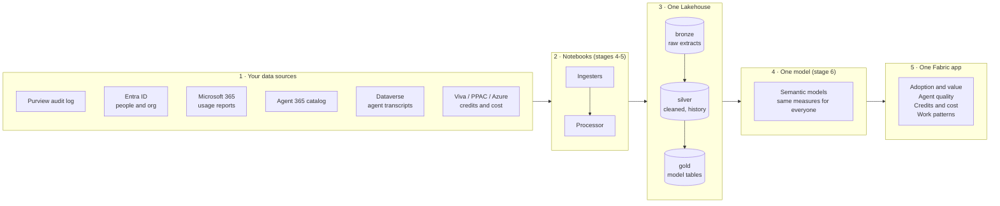
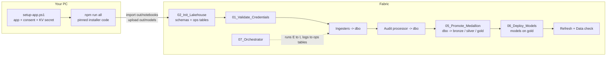
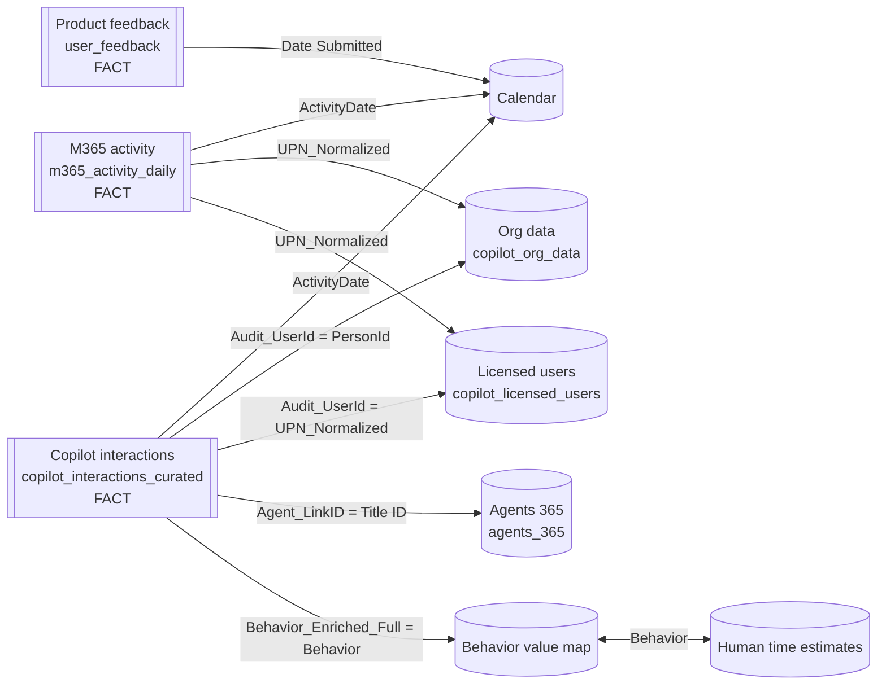

# Universal Data Lake for Microsoft Copilot data

Build **one Microsoft Fabric Lakehouse** that holds every Copilot and agent data source, organised as **bronze, silver and gold**, with a **semantic model** on top. You run it **one visible step at a time**, so that when something fails you know which step, which source, which time window, and how to re-run just that part.

* **Proven extract code, pinned.** The ingester, processor and refresh notebooks and the semantic model definitions are generated from a **pinned commit** of an open-source Fabric installer (the *source repo*, see [prerequisites](00-prerequisites/README.md)) with `npm run all`. Nothing is re-implemented, and nothing changes until you move the pin.
* **Medallion layout.** The installer's notebooks write to `dbo`, unchanged. A promote step copies every table into exactly one of `bronze`, `silver` or `gold`, and the semantic models read **`gold` only**.
* **Traceable.** Every step writes a row to `ops.run_log`. Every history window (audit backfill, transcripts, snapshots) goes to `ops.backfill_ledger`, and every promoted table to `ops.table_layers`.
* **Explicit backfills and reruns.** `RUN_MODE` (`first_load`, `backfill` or `incremental`) and the backfill days are printed as a plan before anything runs. You can re-run only the failed steps of a run, or start from any step.

## The idea in one picture: pull once, model once, share everywhere

Every Copilot data source lands in **one Lakehouse**, sits behind **one semantic model**, and is shared through **one Fabric app**. Each report reads the same tables, so nobody re-pulls the APIs for each new question, and there is one governed set of definitions instead of a PBIX per team. Every source except the core audit feed is optional: start small and turn extras on when you are ready.



## Data sources at a glance

What each source holds, which notebook pulls it, the gold table it ends up in, and the permission that unlocks it. The module name is the key in `config.json` → `dataSources` and in `setup-app.ps1 -Modules`.

| Source (portal) | What it holds | Notebook | Gold table | Access needed | Module |
|---|---|---|---|---|---|
| Copilot interactions (Purview audit) | Every Copilot prompt and agent run: user, app, time, resources touched | Audit ingester, then processor | `copilot_interactions_curated` | `AuditLogsQuery.Read.All` | `core` |
| Licensed users (M365 admin center reports) | Who holds a Copilot licence, last activity per app | Licensed users ingester | `copilot_licensed_users` | `Reports.Read.All` | `core` |
| Org data (Entra ID) | Department, job title, country, manager chain | Org data ingester | `copilot_org_data` | `User.Read.All` | `orgData` |
| M365 app usage (6 Graph reports) | Daily Teams, Outlook, SharePoint, OneDrive, Viva Engage and app use per person | M365 activity ingester | `m365_activity_daily` | `Reports.Read.All` | `m365Activity` |
| Agent 365 (agent registry) | Agents in the tenant: publisher, status, owners | Agent365 registry ingester | `agents_365` | `CopilotPackages.Read.All`, `Application.Read.All` | `agent365` |
| Product feedback (M365 admin center) | Thumbs up / down and comments on Copilot | Product feedback ingester | `user_feedback` | CSV you upload; no API permission | `productFeedback` |
| Copilot Studio transcripts (Dataverse) | Sessions, turns, errors, knowledge use per agent | Transcript parser | `agent_sessions`, `agent_turns`, … | App added as a Dataverse application user (Bot Transcript Viewer) | `agentEvaluator` |
| Studio credits (Power Platform admin center) | Copilot Studio credits by environment, agent and user | Studio lander | `studio_*` | CSV export (Global or Billing Admin) | `studioCredits` |
| Cowork credits (Viva Insights) | Copilot credits per person, spending policies | Viva consumption lander | `viva_credits_weekly`, … | CSV export (Viva Insights Analyst) | `coworkCredits` |
| Azure AI cost (Cost Management, Monitor) | Daily AI spend and tokens | Azure AI ingester | `azure_ai_spend`, `azure_ai_tokens` | Cost Management Reader, Monitoring Reader | `azureAi` |

Two settings trip up most first runs:

* **Concealed user names.** If *M365 admin center → Settings → Org settings → Reports* conceals names, the usage reports return 32-character IDs instead of UPNs and nothing joins. Turn it off before the first run.
* **Blank Entra fields.** An empty department or manager in Entra shows up as a blank in every org slicer.

## The stages

| # | Folder | You do | Where |
|---|---|---|---|
| 0 | [`00-prerequisites`](00-prerequisites/README.md) | Check roles, licences, tenant settings and tools | Admin portals |
| 1 | [`01-app-registration`](01-app-registration/README.md) | Create the app, grant permissions, store its secret in Key Vault | `setup-app.ps1` (az CLI) |
| 2 | [`02-lakehouse`](02-lakehouse/README.md) | Create a workspace and a **schema-enabled** Lakehouse, fill in `config.json` | Fabric portal |
| 3 | [`03-build-and-import`](03-build-and-import/README.md) | `npm run all`, import `out/notebooks`, upload model files, run `02_Init_Lakehouse` and `01_Validate_Credentials` | Your PC, then Fabric |
| 4 | [`04-ingest`](04-ingest/README.md) | Run the ingesters, first by hand and then from the orchestrator | Fabric notebooks |
| 5 | [`05-process`](05-process/README.md) | Run the audit processor, then promote `dbo` to bronze, silver and gold | Fabric notebooks |
| 6 | [`06-semantic-model`](06-semantic-model/README.md) | Create the models, bind their connection, refresh them, check row counts | `06_Deploy_Models` |
| 7 | [`07-orchestrate`](07-orchestrate/README.md) | Run everything in order and schedule it; [re-run what failed](07-orchestrate/RERUNS.md) | `07_Orchestrator` |



## Quick start

```powershell
git clone <this-repo-url> UniversalLake
git clone https://github.com/microsoft/ValueLens-for-Microsoft-Copilot <source-repo-path>   # the source repo: notebook and model code
cd UniversalLake
copy config.template.json config.json        # fill it in as you go through stages 1 and 2
./01-app-registration/setup-app.ps1 -KeyVaultName <vault> -Modules core,orgData,m365Activity
npm run all                                   # check pin -> sync notebooks -> build models -> build notebooks
```

Then, in Fabric:

1. Import every `.ipynb` in `out/notebooks`.
2. Upload the `out/models` folder into `Files/universal_lake/` (you get `Files/universal_lake/models/`).
3. Run `02_Init_Lakehouse`, then `01_Validate_Credentials`.
4. Run `07_Orchestrator` with `RUN_MODE = 'first_load'` and `DRY_RUN = True`, read the plan, then set `DRY_RUN = False`.
5. Run `06_Deploy_Models` once.
6. Run `07_Orchestrator` again with `STEPS = 'refresh_universal,refresh_consumption,refresh_agent_evaluator,data_check'`.

On every later day, run `07_Orchestrator` with `RUN_MODE = 'incremental'`, which is the default. You can schedule it.

## How it maps to the installer

| Installer step | Here |
|---|---|
| Sign-in, app registration, Graph consent, secret to Key Vault | `setup-app.ps1`, checked by `01_Validate_Credentials` |
| Create workspace and Lakehouse | Fabric portal (stage 2), checked by `02_Init_Lakehouse` |
| Upload notebooks with parameters filled in | `npm run sync` (installer `transform/notebooks.js`), then import |
| Create the semantic models and point them at the Lakehouse | `npm run models` (installer `transform/model.js`, schema `dbo` replaced by `gold`), then `06_Deploy_Models` |
| SQL connection and binding | `06_Deploy_Models` (`CONNECTION_MODE = 'spn'`) |
| `CopilotAdoptionPipeline` | `07_Orchestrator`: the same activities, order, timeouts and scale profiles, run in sequence |
| First run as a backfill | `RUN_MODE = 'first_load'` |

## What is in the Lakehouse afterwards

| Schema | Contents |
|---|---|
| `dbo` | The installer notebooks' working tables. Leave them alone: incremental loads read their own previous output from here. |
| `bronze` | Raw extracts and logs, such as `copilot_interactions_parsed`, `*_raw`, upload and load logs |
| `silver` | Cleaned intermediate and history tables that no model reads |
| `gold` | Exactly the tables the semantic models read (`out/models/gold_tables.json`) |
| `ops` | `config`, `run_log`, `backfill_ledger`, `table_layers` |

### How the gold tables join

The main model is a star. Copilot interactions and M365 activity are the two fact tables, and they share the person and date dimensions. The person key everywhere is the lower-cased UPN.



Things to know when a number looks wrong:

* **Guests and service accounts** have no org row, so they show as unmapped.
* **Licences are a current snapshot.** They are not kept as history, so licence trends need a daily snapshot.
* **Agent IDs in the audit log don't match the catalog directly.** The processor builds `Agent_LinkID` by trying the Entra ID, then the title ID, then the agent name.
* **There is no relationship between the two facts.** DAX bridges them on person and date.

## Updating the source code

1. Pull the source repo clone.
2. Set `pinnedCommit` in `config.json` to the new commit, then run `npm run all`.
   * `check` confirms the clone is at the pin.
   * `sync` lists which notebooks changed since the last sync (compared with `out/SOURCE.lock.json`).
   * `models` fails loudly if a model template changed shape.
3. Re-import the changed notebooks and re-upload `out/models`.
4. Run `06_Deploy_Models` (it updates the models in place) and then `07_Orchestrator`.

## Keeping IDs, secrets and personal details out of the repo

Your tenant ID, client ID, workspace and Lakehouse IDs belong only in `config.json`, which is git-ignored. The client secret lives only in Key Vault. `scripts/scan_sensitive.mjs` fails if anything that would be committed contains:

* a GUID (tenant, client, workspace or object ID), except public IDs such as Microsoft Graph's
* a client secret, password, storage key, SAS signature, private key, JWT or GitHub token
* a personal path (`C:\Users\<name>`, `/home/<name>`), an email address, a personal OneDrive/SharePoint link or a tenant `*.onmicrosoft.com` domain
* a notebook with saved outputs or a Lakehouse binding
* any term you list in `.scan-blocklist`, such as your alias or tenant name (one per line; this file is git-ignored)

It runs in three places:

```powershell
git config core.hooksPath .githooks   # once per clone: scans staged files before every commit
npm run scan                          # whole repo plus commit author emails (must be GitHub noreply)
```

The `sensitive-content-scan` GitHub Actions workflow runs the same check on every push and pull request.

## Repository layout

```
config.template.json   copy to config.json (git-ignored); no secrets in it
scripts/               check_source, sync_notebooks, build_models (Node, import the source repo's installer);
                       build_ipynb (Python); scan_sensitive (secret and personal-data check)
.githooks/, .github/   pre-commit hook and CI workflow that run scan_sensitive
notebook-src/          readable sources of this repo's notebooks (# %% cells) -> built into the stage folders
0x-*/                  one folder per stage: README plus that stage's notebook or script
out/                   generated, git-ignored: notebooks to import, model definitions, SOURCE.lock.json
```
